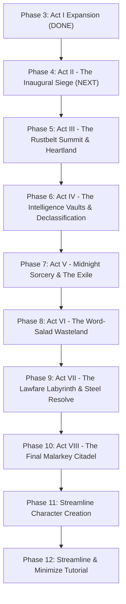

# COMMANDER AMERICA RPG — MASTER ROADMAP & AI HANDOFF PLAN

> **FOR THE NEXT AI ASSISTANT:**
> Read this document completely before starting work. It contains the exact project architecture, current completion state, testing protocols, and step-by-step instructions for the next phase (**Phase 4: Act II Story Expansion**).

---

## 1. Executive Summary & Core Ground Rules

### Project Overview
* **Repository Path:** `/home/todd/Documents/GitHub/commander-america-rpg`
* **App Name:** Commander America RPG (Android / Kotlin / Jetpack Compose / Custom Voice RPG Engine)
* **Testing Command:** `./gradlew testDebugUnitTest --tests "com.voicerpg.engine.CommanderAmericaGameTest"`
* **Build Command:** `./gradlew assembleDebug`
* **Device Target:** Connected via adb (`adb devices`, e.g. `192.168.1.253:42679`)

### Critical Creative & Architectural Guidelines
1. **Pure Political Satire (NOT High Fantasy):**
   * There are **NO** mystical ghouls, green ooze, cursed warlock dungeons, or high-fantasy sorcery.
   * The "Swamp" refers strictly to **unelected D.C. bureaucrats, K-Street corporate lobbyists, focus-grouped dynasty candidates, super PAC consultants, and biased cable news pundits**.
   * Enemies, bosses, locations, and dialogue must remain authentic, punchy political satire with humor and wit.
2. **Episodic Chapter Structure:**
   * Each Act is split into **2 to 5 distinct chapters**, scaling progressively longer toward the climax.
   * Every chapter features:
     - Distinct setting/scene in `StoryScript.kt` (with background asset and ambient description)
     - Interactive dialogue progression with multiple-choice forks, signature swagger/lore inquiries, and narrator reactions
     - A dedicated combat encounter in `StoryEncounters.kt`
     - Clean transition to the next chapter (or next Act upon finale)
     - Debug chapter warp entry in `StoryViewModel.kt` (`DEBUG_CHAPTER_TARGETS`)
3. **Party Progression Across Acts:**
   * **Act I:** Solo Commander America (`hero`).
   * **Act II:** Marco Rubio joins (`marco` — Sanctions Sorcerer).
   * **Act III:** JD Vance joins (`vance` — Rustbelt Vanguard).
   * **Act IV:** Kash Patel joins (`kash` — Intel Inquisitor).
   * **Act V:** Senator Kennedy joins (`kennedy` — Committee Cross-Examiner).
   * Front/Back row combat layout: 5-hero supergroup arranged 3 front, 2 back.

## 2. Character & Narrator Roster Directory

### A. The Protagonist
* **`COMMANDER_AMERICA` (`hero`):** Commander-in-Chief of Freedom.
  - Spells (8): *Tremendous Strike*, *Art of the Deal*, *Obama Did It First!*, *Presidential Veto*, *Executive Action*, *Build The Wall*, *Rally The Patriots*, *Tired of Winning!*

### B. The 4 Playable Companions (5-Hero Supergroup)
* **`MARCO` (`marco`):** Marco Rubio — Secretary of State / *Sanctions Sorcerer* (Recruited in Act II).
  - Spells: *Filibuster Strike*, *Maximum Sanctions*, *Water Sip Restore*, *Tariff Dividend*.
* **`VANCE` (`vance`):** JD Vance — The Vice President / *Rustbelt Vanguard* (Recruited in Act III).
  - Spells: *Hillbilly Debate Strike*, *Midwest Factory Slam*, *Heartland Fortitude*, *Common Sense Strike*.
* **`KASH` (`kash`):** Kash Patel — FBI Director / *Intel Inquisitor* (Recruited in Act IV).
  - Spells: *Declassify Document*, *The Government Gangster Binder*, *Security Clearance Revocation*, *Plug the Leaks*.
* **`KENNEDY` (`kennedy`):** Senator John Kennedy — *Committee Cross-Examiner* (Recruited in Act V).
  - Spells: *Plain English Cross-Examination*, *Call a Cop Strike*, *Metaphorical Remedy*, *Folksy One-Liner*.

### C. The Broadcast Narrator Trio (Rotating Newsroom & Arena Anchors)
* **`NARRATOR_KAYLEIGH` (`narrator_kayleigh`):** Anchor Kayleigh McEnany — Primetime Desk Anchor (Cool, sharp, facts-driven).
* **`NARRATOR_KAROLINE` (`narrator_karoline`):** Karoline Leavitt — Press Secretary of Truth (Fast, punchy, unyielding binder of receipts).
* **`NARRATOR_HULK` (`narrator_hulk`):** The Hulkster — 24-Inch Pythons / Ringside Hype ("OH YEAH, BROTHER!").

### D. Allies & Political Antagonists / Bosses
* **Allies:**
  - `ELON` (`elon`): Elon Musk — Chief Doge & Starship Sovereign.
* **Antagonists & Bosses:**
  - `MEDIA_ANCHOR` (`media_anchor`): Cable News Anchor / Smug Primetime Pundit.
  - `ESTABLISHMENT_RIVAL` (`establishment_rival`): Low-Energy Dynasty Candidate ("please clap").
  - `PARTY_BOSS` (`party_boss`): Establishment Party Boss & Delegate Broker.
  - `PELOSI` (`pelosi`): Madam Speaker Pelosi — Stock-Trading Shadow Lich (Act II Boss).
  - `ROCKET_MAN` (`rocket_man`): Chairman of the Crimson Spire (Act III Summit Boss).
  - `OBAMA` (`obama`): Barack — The Teleprompter Sorcerer.
  - `KAMALA` (`kamala`): The Unburdened Vice-Sovereign (Act VI Boss).
  - `BIDEN` (`biden`): Final Boss Biden — The Malarkey Sovereign (Act VIII Boss).

---

### E. CRITICAL INSTRUCTION: PURGE DEPRECATED FANTASY CHARACTERS ON SIGHT
> **WARNING FOR FUTURE AI ASSISTANTS:**
> The original codebase was a generic medieval/mystic fantasy RPG ("Voice RPG") before being completely transformed into *Commander America RPG*.
> **DO NOT USE, INTRODUCE, OR REFERENCE ANY OF THE FOLLOWING RETIRED CHARACTERS:**
> - `Aethel` (Elementalist)
> - `Sir Cedric` (Oathkeeper Templar)
> - `Lyra` (Grove Warden)
> - `Zephyr` (Shadowblade)
> - `Grand Inquisitor Malakor` (The Mute Sovereign)
> - `Commander Vaelor` (The Voice-Thief)
> - `Sir Galahault` (Obsidian Grandmaster)
> - `Master Nocturne` (Spymaster of the Mute)
> - `Warmaster Ouros` (Clockwork Warmaster)
> - `Dryad Matron` (Elder Dryad)
> - `Shadow Wisp`, `Blighted Husk`, `Willow Tree`, `Mire Wyrm`, `Broodmother`
>
> **Action required:** As you work through the remaining phases (story expansion, UI, tests, cleanup), whenever you encounter references, assets, or fallback code mentioning these old fantasy characters, **remove them or replace them** with the valid *Commander America* characters above so they are not accidentally re-introduced or treated as valid game lore.

---

## 3. Completed Phases Log

* [x] **Phase 1: Intent Parser Disambiguation & Spell Chant Presets**
  - Implemented 3-level hierarchical matcher (Exact Name $\rightarrow$ Multi-Word Alias $\rightarrow$ Single-Word Alias / Name Words) in `IntentParser.kt`.
  - Added dedicated chant presets for all 24 spells across all 5 heroes in `SpellChantPresets.kt`.
  - Fixed mana recovery spell turn-check bug in `CombatViewModel.kt`.
  - Added unit test `testAllSpellsAtMaximumResonanceDebugPresetsResolveCorrectly` (120/120 combinations pass).
* [x] **Phase 2: Two-Row Combat Arena Party Layout**
  - Updated `PartyFlank.kt` to arrange party members in 2 rows (3 front-row vanguards, 2 back-row specialists).
* [x] **Phase 3 (Act I): The Rise of Commander America (3 Full Chapters)**
  - **Chapter 1: The Golden Descent** (Trump Tower Atrium & Escalator, June 2015) — `act1_ch1_intro`, strategy hub (Trade, Wall, Swamp), lobby press ambush, `act1_ch1_press_battle`.
  - **Chapter 2: The Primary Debate Arena** (Quicken Loans Arena, Cleveland, August 2015) — `act1_ch2_intro`, donor expose, Low-Energy Dynasty Candidate (*"please clap"*), counter-punch roast choices, `act1_ch2_debate_battle`.
  - **Chapter 3: The New Hampshire Snowstorm & Primary Sweep** (Manchester Airport Hangar, February 2016) — `act1_ch3_intro`, 15k patriot rally speech, confrontation with the Establishment Party Boss and backroom delegate brokers, `act1_ch3_machine_battle`, landslide primary victory finale.
  - Added scenes `SCENE_ACT1_CH1_ESCALATOR`, `SCENE_ACT1_CH2_DEBATE`, `SCENE_ACT1_CH3_RALLY`.
  - Added debug chapter warps with solo Commander America seeding in `StoryViewModel.kt`.
  - All unit tests passing in `CommanderAmericaGameTest.kt`. Installed and verified on physical device.

---

## 3. Master Phase Roadmap (Next Up: Phase 4)

### Detailed Breakdown of Remaining Phases:

### **PHASE 4 (NEXT): Act II — The Inaugural Siege & Media Wars (2017)**
* **Chapters:** 3 Chapters
  - **Chapter 1: The Inaugural Address & The Crowd Size Dispute** (National Mall / Capitol Steps)
    - Dialogue: The golden address, "American Carnage" to American Renewal, calling out the cable networks cropping the aerial photography.
    - Encounter: *Cable News Aerial Spin Crew* & *Hostile Fact-Checker*.
  - **Chapter 2: Entering the Oval Citadel & The Executive Pen** (The Oval Office)
    - Dialogue: Commander America takes the Resolute Desk, replacing curtains with gold drapes, signing deregulation orders.
    - **Marco Rubio Joins:** Marco arrives with his leather-bound briefcases and bottle of Florida water, joining as the *Sanctions Sorcerer*!
    - Dialogue hub: Foreign policy doctrines, tariffs on unfair trade, shutting down wasteful foreign aid.
  - **Chapter 3: Confronting Madam Speaker & The Stock-Trading Lich** (Capitol Rotunda / Committee Hall)
    - Dialogue: Confronting Pelosi over insider microchip trades right before regulatory votes.
    - Encounter: `ACT2_MEDIA_BATTLE` (Boss: *Madam Pelosi - Stock Lich*, *Biased Fact-Checker Ghoul*, *Anonymous Source Phantom*).
* **Deliverables:**
  - Create scenes in `StoryScript.kt` (`scene_act2_ch1_mall`, `scene_act2_ch2_oval`, `scene_act2_ch3_rotunda`).
  - Create encounters in `StoryEncounters.kt` and wire into `ALL_ENCOUNTERS`.
  - Wire Marco Rubio recruitment upon entering Chapter 2.
  - Add debug warps for Act II chapters in `StoryViewModel.kt`.
  - Add unit tests in `CommanderAmericaGameTest.kt`.
  - Build and install to device.

---

### **PHASE 5: Act III — The Rustbelt Summit & Heartland / Summit of Peace (2018)**
* **Chapters:** 4 Chapters
  - **Chapter 1: The Ohio Steel Mill Awakening** (Youngstown / Lordstown, OH) — JD Vance joins as *Rustbelt Vanguard*!
  - **Chapter 2: The NAFTA Renegotiation Showdown** (USMCA Drafting Room).
  - **Chapter 3: The Demilitarized Zone Flight** (En route to the DMZ on Air Force One).
  - **Chapter 4: The Crimson Summit of Peace** (The 38th Parallel Table with Rocket Man).
* **Deliverables:** Dialogue tree, encounters (including Rocket Man), Vance recruitment, debug warps, tests.

---

### **PHASE 6: Act IV — The Intelligence Vaults & Declassification (2019)**
* **Chapters:** 4 Chapters
  - **Chapter 1: The FISA Warrant Labyrinth** (Hoover Building Sub-Basement) — Kash Patel joins as *Intel Inquisitor*!
  - **Chapter 2: The Unredacted Binder Inquest** (House Intelligence Vault).
  - **Chapter 3: The Phantom Subpoena Ambush** (Federal Courtroom Steps).
  - **Chapter 4: The Mueller Illusion Hoax Climax** (Special Counsel Hearing Room).
* **Deliverables:** Dialogue tree, encounters (Special Counsel Phantoms), Kash recruitment, debug warps, tests.

---

### **PHASE 7: Act V — Midnight Sorcery & The Exile (2020-2021)**
* **Chapters:** 4 Chapters
  - **Chapter 1: The 3:00 AM Water Pipe Mystery** (State Farm Arena Ballot Storage Room).
  - **Chapter 2: The Senate Inquest** — Senator John Kennedy joins as *Committee Cross-Examiner* ("It will take a miracle to fix this, and frankly, God is busy").
  - **Chapter 3: The Southern White House** (Mar-a-Lago Terrace & Palm Beach Briefing).
  - **Chapter 4: The Deep State Raid on the Golden Closets** (Mar-a-Lago Storage Room Showdown).
* **Deliverables:** Dialogue tree, encounters, Kennedy recruitment, debug warps, tests.

---

### **PHASE 8: Act VI — The Word-Salad Wasteland (2022-2023)**
* **Chapters:** 5 Chapters
  - **Chapter 1: The Border Czar Inspection** (The Missing Border Wall Gap).
  - **Chapter 2: The Venn Diagram Fog** (Endless loops of unburdened circular logic).
  - **Chapter 3: The Electric School Bus Mire** (Stranded EV Convoy).
  - **Chapter 4: The Coconut Tree Grove** (Floating in the context of all in which you live).
  - **Chapter 5: The Unburdened Vice-Sovereign Confrontation** (Kamala Boss Battle).

---

### **PHASE 9: Act VII — The Lawfare Labyrinth & Steel Resolve (2024)**
* **Chapters:** 5 Chapters
  - **Chapter 1: The 91 Indictment Gauntlet** (Fulton County & Lower Manhattan Courts).
  - **Chapter 2: The Gag Order Guillotine** (Contempt Hearing with Biased Judges).
  - **Chapter 3: The Butler, PA Fairgrounds** (The Open Sky & Rally Stage).
  - **Chapter 4: The Bullet Deflection & Steel Ear Miracle** ("FIGHT! FIGHT! FIGHT!").
  - **Chapter 5: The Milwaukee Arena Coronation** (The Golden Bandage & Unified Coalition).

---

### **PHASE 10: Act VIII — The Final Malarkey Citadel & Golden Inauguration**
* **Chapters:** 5 Chapters
  - **Chapter 1: The Basement Bunker Breach** (Wilmington Virtual Studio).
  - **Chapter 2: The Teleprompter Jammer** (Scranton Train Platform).
  - **Chapter 3: The Auto-Pen Phantoms** (Executive Order Factory).
  - **Chapter 4: The Malarkey Sovereign Climax** (Boss: Final Boss Biden & Scoops of Vanilla Ice Cream).
  - **Chapter 5: The Golden Inauguration & Golden Age of America** (Epilogue / Victory Parade down Pennsylvania Avenue).

---

### **PHASE 11: Streamline Character Creation**
* **Goal:** Remove class selection bloat from `CharacterCreationScreen.kt` and `SaveManager.kt`.
* **Details:** Commander America doesn't need fantasy classes (Elementalist/Templar/Warden/Shadowblade). He is always *Commander-in-Chief*, equipped with his 8 signature spells (*Tremendous Strike*, *Art of the Deal*, *Obama Did It First!*, *Presidential Veto*, *Executive Action*, *Build The Wall*, *Rally The Patriots*, *Tired of Winning!*).
* Allow player cosmetic/name customization while skipping unnecessary archetype selection.

---

### **PHASE 12: Streamline & Minimize Tutorial**
* **Goal:** Revise `TutorialBattleViewModel.kt` and tutorial UI so it is concise, fast-paced, and hilarious rather than slow and tedious.

---

## 4. Key Source Files Quick Reference

| Feature | Key File Path |
|---|---|
| **Dialogue & Scenes** | `app/src/main/java/com/voicerpg/engine/engine/StoryScript.kt` |
| **Combat Encounters** | `app/src/main/java/com/voicerpg/engine/engine/StoryEncounters.kt` |
| **Story Progression & Warps** | `app/src/main/java/com/voicerpg/engine/viewmodel/StoryViewModel.kt` |
| **Hero Kits & Spells** | `app/src/main/java/com/voicerpg/engine/template/TemplateHero.kt` |
| **Voice Parsing & Intent** | `app/src/main/java/com/voicerpg/engine/engine/IntentParser.kt` |
| **Chant Presets** | `app/src/main/java/com/voicerpg/engine/engine/SpellChantPresets.kt` |
| **Game Unit Tests** | `app/src/test/java/com/voicerpg/engine/CommanderAmericaGameTest.kt` |
