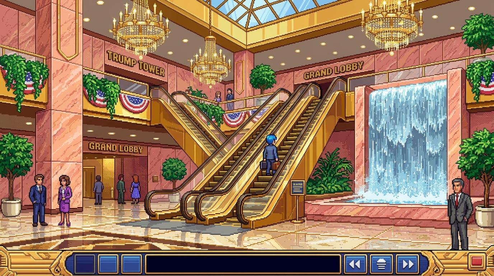
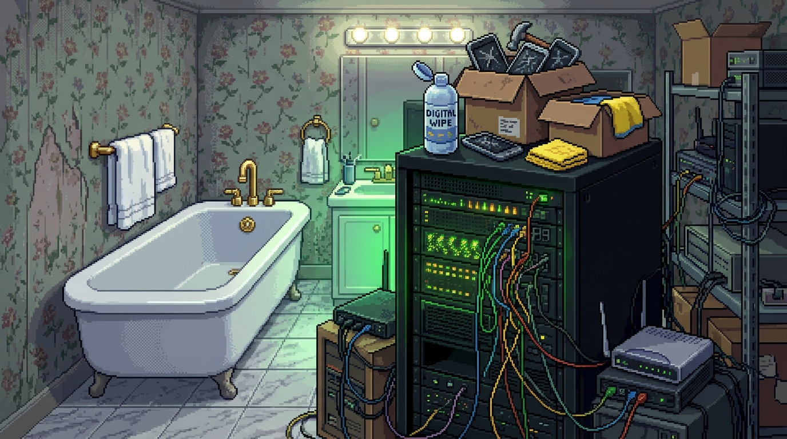
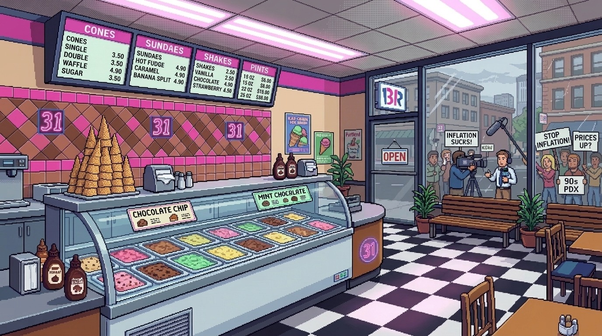
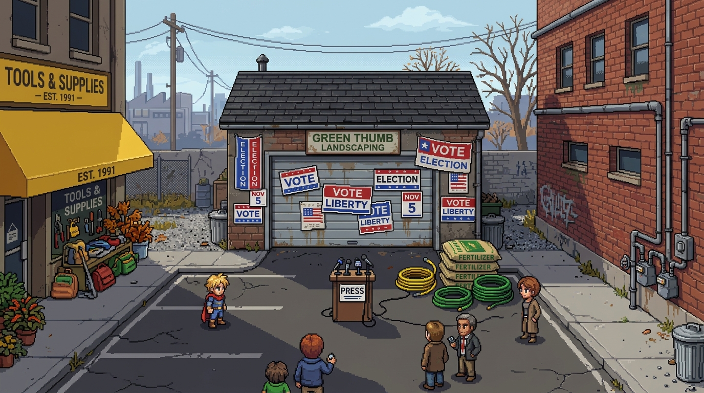
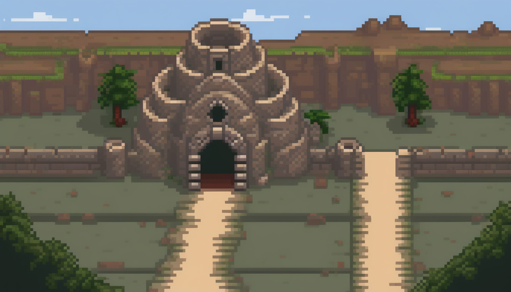
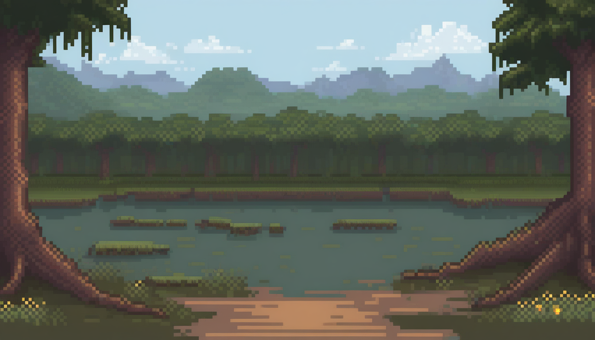

<p align="center">
  <a href="https://ko-fi.com/todd0042">
    
  </a>
</p>

---

# 🇺🇸 Commander America RPG

[](https://github.com/Todd0042/commander-america-rpg/releases)
[](LICENSE)
[-3DDC84.svg?logo=android&logoColor=white)](https://developer.android.com)
[](https://kotlinlang.org)
[](https://developer.android.com/jetpack/compose)
[](https://github.com/Todd0042/voice-rpg-engine)
[](app/src/main/java/com/voicerpg/engine/audio/SpeechManager.kt)
[](https://developer.android.com/16kb-page-size)
[](app/src/test/java/com/voicerpg/engine/)
[](https://ko-fi.com/todd0042)

> **A voice-commanded political satire JRPG for Android: two campaigns told from opposite sides of the aisle (Red "Paint it Red" and Blue "Bewilder with Blue"), spells you shout into your phone and learn as the story unfolds, real-audio sound bites, and a game you can finish entirely by ear in Pocket Mode.**

---

## 📖 Table of Contents

* **Part 1 — Overview & Quick Start**
  * [🎮 What Is Commander America RPG?](#-what-is-commander-america-rpg)
  * [🧭 How a Rally Works in 3 Steps](#-how-a-rally-works-in-3-steps)
  * [🔴 Two Campaigns: Paint it Red and Bewilder with Blue](#-two-campaigns-paint-it-red-and-bewilder-with-blue)
  * [👥 Who Fights, and When They Join](#-who-fights-and-when-they-join)
  * [📸 Visual Tour](#-visual-tour)
  * [✨ Highlights at a Glance](#-highlights-at-a-glance)
  * [🚀 Quick Download & Installation](#-quick-download--installation)
* **Part 2 — Technical Documentation & Architecture Reference**
  * [1. Architecture & the Shared Engine ([GameContent.kt](app/src/main/java/com/voicerpg/engine/content/GameContent.kt), [OWNED_PATHS](.engine-sync/OWNED_PATHS))](#1-architecture--the-shared-engine)
  * [2. Campaign Tracks & Story ([manifest.json](app/src/main/assets/game/manifest.json), [nodes.json](app/src/main/assets/game/story/nodes.json), [scenes.json](app/src/main/assets/game/story/scenes.json))](#2-campaign-tracks--story)
  * [3. Party, Roles & Story-Learned Spells ([characters/](app/src/main/assets/game/characters/), [commander.json](app/src/main/assets/game/classes/commander.json), [spells.json](app/src/main/assets/game/spells/spells.json))](#3-party-roles--story-learned-spells)
  * [4. Combat: No Mana, Enemy Types & Weaknesses ([affinity_matrix.json](app/src/main/assets/game/combat/affinity_matrix.json), [enemies.json](app/src/main/assets/game/enemies/enemies.json))](#4-combat-no-mana-enemy-types--weaknesses)
  * [5. Combat Balance ([balance.json](app/src/main/assets/game/combat/balance.json), [encounters.json](app/src/main/assets/game/encounters/encounters.json), [BalanceContractTest.kt](app/src/test/java/com/voicerpg/engine/balance/BalanceContractTest.kt))](#5-combat-balance)
  * [6. Voice Input & Resonance Scoring ([SpeechManager.kt](app/src/main/java/com/voicerpg/engine/audio/SpeechManager.kt), [ResonanceEngine.kt](app/src/main/java/com/voicerpg/engine/engine/ResonanceEngine.kt))](#6-voice-input--resonance-scoring)
  * [7. Narration, Voices, Music & Sound Bites ([MusicManager.kt](app/src/main/java/com/voicerpg/engine/audio/MusicManager.kt), [SfxManager.kt](app/src/main/java/com/voicerpg/engine/audio/SfxManager.kt))](#7-narration-voices-music--sound-bites)
  * [8. Battle Sprites & Backdrops ([sprite_roster.json](art/sprite_roster.json), [environments.json](app/src/main/assets/game/environments/environments.json))](#8-battle-sprites--backdrops)
  * [9. Engine Sync Workflow ([.engine-sync/](.engine-sync/))](#9-engine-sync-workflow)
  * [10. Repository Structure](#10-repository-structure)
  * [11. Running the Tests ([CommanderAmericaContentTest.kt](app/src/test/java/com/voicerpg/game/CommanderAmericaContentTest.kt))](#11-running-the-tests)
  * [12. Ethics, Provenance & Licensing ([LICENSE](LICENSE), [LICENSE-MEDIA](LICENSE-MEDIA))](#12-ethics-provenance--licensing)

---

# Part 1 — Overview & Quick Start

## 🎮 What Is Commander America RPG?

**Commander America RPG** is an equal-opportunity political satire JRPG for Android, covering American politics from the 2015 golden escalator to a 2026 bipartisan roast. Instead of tapping menus, you **speak**: call out a spell (*"Tremendous strike!"*, *"Cloth wipe!"*), name who it's for (*"Security clearance Marco"*), or pick a story choice out loud.

It is built for players who want a comedy RPG they can play hands-free, and on the shared **[VoiceRPG engine](https://github.com/Todd0042/voice-rpg-engine)**. The game has four main parts:

1. **The candidate select**: pick Commander America (Red) or Hill-Rod (Blue); the pick chooses your campaign.
2. **The story**: five Acts of narrated, branching scenes with six rotating satirical narrators.
3. **Voice-commanded battles**: 35 story fights where how you speak a spell changes how hard it hits.
4. **Pocket Mode**: the whole game read aloud and answered by voice, with the screen locked.

---

## 🧭 How a Rally Works in 3 Steps

1. **Speak to command**: on a fighter's turn, say a spell and, for heals, who it's for (*"Rally the patriots, heal Marco"*).
2. **Say it like you mean it**: the on-device **Resonance Engine** scores your words, volume and inflection, and the score multiplies the spell's effect.
3. **Listen**: the narrator, each character's own TTS voice and real-audio sound bites react to what happened.

---

## 🔴 Two Campaigns: Paint it Red and Bewilder with Blue

Both campaigns run through **five Acts (2015–2026)**, about **24 chapters each**, and end in a shared **bipartisan curtain call**:

- **🔴 Paint it Red** (`track_a`): **Commander America** from the golden escalator to the 2026 grand finale, building a five-fighter coalition along the way.
- **🔵 Bewilder with Blue** (`track_b`): a **relay** told by **Hill-Rod**. Each Act hands the spotlight to a new lead, and the earlier leads stay in the party, so the team grows from one fighter to six.

---

## 👥 Who Fights, and When They Join

| Track | Fighter | Joins | Role |
|---|---|---|---|
| Red | **Commander America** | Act I | Main character: attacks + targetable heal (*Rally The Patriots*) |
| Red | **Little Marco** | Act II, Chapter 1 (after the inauguration fight) | Striker, no heal |
| Red | **Wizard Kash** (Kash Subpoena) | Act II, Chapter 4 (the SCIF) | Large targetable heal (*Security Clearance*) |
| Red | **Foghorn Kennedy** | Act III, Chapter 2 | Healer: party heal (*Common Sense Remedy*) and strong single heal (*Bless Your Heart*) |
| Red | **JD Pants** | Act IV, Chapter 1 (the donut shop) | Striker, no heal |
| Blue | **Hill-Rod** | Act I | Main character: attacks + targetable heal (*11-Hour Marathon Shield*) |
| Blue | **Nancy Palooza** | Act II | Striker, no heal |
| Blue | **Joe Naptime** | Act III | Blue's healer: party heal (*Baskin-Robbins Lick*) and strong single heal (*9:00 AM Lid & Sundae Nap*) |
| Blue | **Kamala Coconut** | Act IV | Striker, no heal |
| Blue | **Zohran Cardamom** & **Mayor Swagger** | Act V | Strikers, no heal |

Every fighter starts with **one single-target attack** (plus their role's heals) and **learns the rest of their kit at story milestones**: chapter victories, Act finales and the openings of their own chapters. A spoken line announces it (*"Little Marco learns Maximum Sanctions"*). Fighters who join later arrive already knowing the spells tied to milestones they missed, and still learn more after joining; on Blue, earlier leads keep learning after they hand over. Spells are only ever added, never swapped out.

---

## 📸 Visual Tour

### Story Scenes

| **The Golden Escalator** | **The Chappaqua Server Room** |
|---|---|
|  |  |
| *Red's opening scene and the title screen backdrop (June 2015).* | *Blue's opening scene: Hill-Rod, a cloth and a server.* |

| **Baskin-Robbins, Portland** | **Four Seasons Total Landscaping** |
|---|---|
|  |  |
| *Act III's ice-cream showdown with Joe Naptime.* | *Blue's Act II finale against Rudy Ghoul.* |

### Battle Backdrops

| **Castle** | **Swamp** |
|---|---|
|  |  |
| *One of five pixel-art battle backdrops.* | *Each backdrop has a painted floor line the fighters stand on.* |

---

## ✨ Highlights at a Glance

* **🗳️ Two Campaigns, Two Perspectives**: Red follows Commander America's coalition; Blue is a five-Act relay of Democratic leads told by Hill-Rod.
* **🎙️ Voice-First Combat**: spells, targets and story choices are spoken; on-device speech recognition is used where the phone supports it.
* **📜 Spells Learned From the Story**: every fighter starts small and learns their kit at story milestones.
* **❤️ Clear Roles**: main characters heal one ally, Kash has a large targetable heal, Kennedy (Red) and Joe (Blue) heal the whole party.
* **🚫 No Mana**: spells are free; the only thing that matters is what you say and how you say it.
* **🧠 Learned Weaknesses**: enemies belong to satirical types (Politicians, Has-Beens, Props, Pundits ...), and the game remembers which spell schools hit each type hard once you find out.
* **⚖️ Balanced Fights**: every story fight is played by a battle simulator and tuned to round targets.
* **🎧 Real-Audio Sound Bites**: short recordings of real public statements play when certain characters act.
* **🚶 Pocket Mode**: narration, read-aloud choices, voice status reports and auto-listen let you play without looking.
* **🌐 Voice Commands in Six Languages**: English, German, Spanish, French, Italian and Portuguese.

---

## 🚀 Quick Download & Installation

### Android (release APK)

1. Download **`app-debug.apk`** from the latest release on the [Releases page](https://github.com/Todd0042/commander-america-rpg/releases) (currently **v1.7.0**).
2. Install it on an Android 8.0+ phone (API 26 or higher); allow installs from your browser or file manager if asked.
3. Tap **Allow** when the game asks for microphone access.

### Build from source

```bash
# Clone the game (the engine is already copied into it; no separate checkout is needed to build)
git clone https://github.com/Todd0042/commander-america-rpg.git
cd commander-america-rpg

# Build the debug APK
./gradlew assembleDebug

# Install it on a connected phone
adb install -r app/build/outputs/apk/debug/app-debug.apk
```

---

# Part 2 — Technical Documentation & Architecture Reference

> *The sections below are a code-verified engineering reference: every file, field and number is taken from the current repository.*

## 1. Architecture & the Shared Engine

Commander America is a **content pack** for the source-available **[VoiceRPG engine](https://github.com/Todd0042/voice-rpg-engine)**, which also runs echoes-of-logos, wallys-world and superstore-saga. The engine code (`com.voicerpg.engine.*`) is an exact, read-only copy; everything that makes this game Commander America is JSON and art under `app/src/main/assets/`.

```
+-------------------------------------------------------------+
|  Engine (read-only copy, com.voicerpg.engine.*)             |
|  ui/ (Compose)  viewmodel/  combat/  audio/  story/  engine/|
+-------------------------------------------------------------+
                 |  GameContent.kt loads at startup
                 v
+-------------------------------------------------------------+
|  Game content (this repo)                                   |
|  game/manifest.json   story/  characters/  classes/         |
|  spells/  enemies/  encounters/  combat/  sprites/          |
|  portraits/  story/ art  environments/  audio/              |
+-------------------------------------------------------------+
```

| Layer | Where | Owned by |
|---|---|---|
| Engine code | `app/src/main/java/com/voicerpg/engine/` | Engine (see [OWNED_PATHS](.engine-sync/OWNED_PATHS)) |
| Voice commands and engine UI phrases | `game/commands/`, `game/localization/` | Engine |
| Engine tests | `app/src/test/java/com/voicerpg/engine/` | Engine |
| Story, characters, spells, enemies, fights | `app/src/main/assets/game/` | This game |
| Story translations | `game/translations/strings_{de,es,fr,it,pt}.json` | This game |
| App identity (`com.commanderamerica.app`, name, icon) | [app/build.gradle.kts](app/build.gradle.kts), `app/src/main/res/` | This game |
| Game tests | [app/src/test/java/com/voicerpg/game/](app/src/test/java/com/voicerpg/game/) | This game |

Build settings: `minSdk 26`, `targetSdk 35`, Kotlin 2.0.21, Compose BOM 2024.10.01, `versionName "1.7.0"`.

---

## 2. Campaign Tracks & Story

### Manifest

[manifest.json](app/src/main/assets/game/manifest.json) sets `creationMode: "preset_select"`, so character creation is a pick between the two tracks' heroes, and `combatResource: "none"` (no mana, see section 4).

| Track | `id` | Hero | Start node / scene | Voice keywords (sample) |
|---|---|---|---|---|
| **Paint it Red** | `track_a` | Commander America (class `commander`) | `act1_intro` / `scene_act1_ch1_escalator` | "commander", "paint it red", "red" |
| **Bewilder with Blue** | `track_b` | Hill-Rod (`hero.characterId: "hill_rod"`) | `act1_tb_ch1_intro` / `scene_act1_tb_ch1_server` | "hill rod", "bewilder with blue", "relay" |

Red's hero is built from the `commander` class ([commander.json](app/src/main/assets/game/classes/commander.json)). Blue's hero sets `characterId`, so the track is told by the character [hill_rod.json](app/src/main/assets/game/characters/hill_rod.json): its party starts with Hill-Rod and her own combat spells and grants instead of a class-based hero.

### Story files

| File | Contents |
|---|---|
| [nodes.json](app/src/main/assets/game/story/nodes.json) | **334** dialogue nodes; Red ids are `act1_…`–`act5_…`, Blue ids `act1_tb_…`–`act5_tb_…` |
| [scenes.json](app/src/main/assets/game/story/scenes.json) | **49** scenes: Red Act I (4 chapters) + Acts II–V (5 each), the same for Blue, and one shared curtain-call scene |
| [encounters.json](app/src/main/assets/game/encounters/encounters.json) | **35** story fights: 18 on Red, 17 on Blue |
| `docs/story-design/` | The writing plans and per-Act scripts ([ACT_1_FULL_SCRIPT.md](docs/story-design/ACT_1_FULL_SCRIPT.md) … [ACT_5_FULL_SCRIPT.md](docs/story-design/ACT_5_FULL_SCRIPT.md)) |

Two Red fights keep older ids and names from an earlier act numbering (`act6_ch3_bus_battle`, `act6_kamala_battle`, both labelled "Act VI"); they are fought in Red's **Act IV** (Chapter 3 and the Act IV finale).

### Hub choices

Hub nodes offer several inquiries; each choice carries a `completionFlag` (75 choices do). The engine's [StoryChoiceRules.kt](app/src/main/java/com/voicerpg/engine/story/StoryChoiceRules.kt) and [StoryChoiceMatcher.kt](app/src/main/java/com/voicerpg/engine/engine/StoryChoiceMatcher.kt) filter out finished choices, the story screen marks them **✓ DONE**, and choosing one again by voice is answered with *"That objective has already been completed."*

---

## 3. Party, Roles & Story-Learned Spells

### Joining

Each companion's file in [characters/](app/src/main/assets/game/characters/) has a `joinWhenFlag`; the story sets the flag on entering a node:

| Fighter | `joinWhenFlag` | Set at node |
|---|---|---|
| Little Marco | `red_marco_joined` | `act2_ch1_post_battle` |
| Wizard Kash | `red_kash_joined` | `act2_ch4_scif_intro` |
| Foghorn Kennedy | `red_kennedy_joined` | `act3_ch2_intro` |
| JD Pants (`vance`) | `red_vance_joined` | `act4_ch1_intro` |
| Hill-Rod | `blue_hill_rod_joined` | `act1_tb_ch1_kjp_oprah` |
| Nancy Palooza | `blue_nancy_joined` | `act2_tb_ch1_hill_rod_stays` |
| Joe Naptime | `blue_joe_joined` | `act3_tb_ch1_leads_stay` |
| Kamala Coconut | `blue_kamala_joined` | `act4_tb_ch1_joe_stays` |
| Zohran Cardamom, Mayor Swagger | `blue_act5_leads_joined` | `act5_tb_ch1_relay_stays` |

### Starting kits and heals

Starting spells come from each character's `combat` block (Commander America's from the class's `starterSpellIds`). Heals are defined in [spells.json](app/src/main/assets/game/spells/spells.json) (51 spells):

| Heal | Caster | Target | Heals |
|---|---|---|---|
| Rally The Patriots | Commander America | one ally (`"target": "ally"`) | 25% of max HP |
| 11-Hour Marathon Shield | Hill-Rod | one ally | 25% |
| Security Clearance | Wizard Kash | one ally | **45%** |
| Common Sense Remedy | Foghorn Kennedy | whole party (`hitsAll`) | 25% |
| Bless Your Heart | Foghorn Kennedy | one ally | 45% |
| Baskin-Robbins Lick | Joe Naptime | whole party, also guards | 25% |
| 9:00 AM Lid & Sundae Nap | Joe Naptime | one ally | 45% |

Heal amounts are multiplied by the resonance multiplier (section 6).

### Spell grants

`spellGrants` (`[{ "flag": …, "spellIds": [...] }]`) in the class and character files add spells when a story flag is set, for example:

| Fighter | Flag | Learns |
|---|---|---|
| Commander America (class `commander`) | `red_a1c3_bus_won` | `ca_build_the_wall` |
| Commander America | `red_a1_finale_won` | `ca_art_of_the_deal` |
| Little Marco | `red_a2_finale_won` | `ca_marco_sanction` |
| Wizard Kash | `red_a2c4_scif_won` | `ca_kash_binder` |
| Nancy Palooza | `blue_a2c4_stocks_opened` | `nancy_deep_itm_calls` |
| Joe Naptime | `blue_a3c4_garage_opened` | `biden_gibberish_audio` |
| Zohran Cardamom | `blue_a4_finale_won` | `zohran_bowdoin_stipend` |

A grant whose flag was set before the fighter joined is applied on joining, so late joiners arrive with what the story has passed.

---

## 4. Combat: No Mana, Enemy Types & Weaknesses

### No mana

`combatResource: "none"`: no MP, no spell costs, and nothing on screen or in speech mentions mana (checked by the engine's `CombatResourceContractTest` and `NoManaGameTest`).

### Schools and enemy types

[affinity_matrix.json](app/src/main/assets/game/combat/affinity_matrix.json) renames the engine's schools and families for speech and screen (`schoolNames`, `familyNames`; the ids stay):

| School id | Spoken as | | Family id | Spoken as |
|---|---|---|---|---|
| `PHYSICAL` | **Strongarm** | | `FLESH` | **Politicians** |
| `HOLY` | **Mandate** | | `UNDEAD` | **Has-Beens** |
| `SHADOW` | **Scandal** | | `CONSTRUCT` | **Props** |
| `ELECTROMANCY` | **Viral** | | `VERDANT` | **The Swamp** |
| `CRYOMANCY` | **Gridlock** | | `VOID` | **Pundits** |
| `PYROMANCY` | **Hot Takes** | | `RADIANT` | **Fat Cats** |
| `NATURE` | **Grassroots** | | `SILENCE` | **Bureaucrats** |

Effectiveness runs from a floor of **x0.8** to a ceiling of **x2.0**.

### Enemies, weaknesses and armour

[enemies.json](app/src/main/assets/game/enemies/enemies.json) holds **83** enemies (40 bosses). Each has a `family`, and per-enemy `weak` / `resist` school lists (x2.0 / x0.8, overriding the family table) on 42 of them; 48 carry `armor`, which is taken off every Strongarm (physical) hit, while Viral (lightning) conducts through it. The weakness plan is in [docs/ENEMY_TYPES_PROPOSAL.md](docs/ENEMY_TYPES_PROPOSAL.md).

### Learned weaknesses

Players learn weaknesses by hitting: when a school lands as a weakness, [CombatViewModel.kt](app/src/main/java/com/voicerpg/engine/viewmodel/CombatViewModel.kt) records it per enemy type in the save (the **bestiary**), and the *"Enemies"* voice report adds what is known.

---

## 5. Combat Balance

**Combat balance.** Every story fight is played by the engine's battle simulator (`BalanceContractTest`: the real combat on virtual time, with the party and spells the story has given them at that point): 35 story fights across both tracks. A sensible player at the balance point (**x1.5** resonance, [`combat/balance.json`](app/src/main/assets/game/combat/balance.json)) should win in a target number of rounds with a safety margin that narrows toward the finale, a lazy x1.1 player should be able to lose late bosses, healing should never take over a fight, and Pure Story Mode must win every fight. The enemy HP and attack in [`encounters.json`](app/src/main/assets/game/encounters/encounters.json) were tuned to those targets with the engine's `BalanceTunerTest`; the report of every fight is written to `app/build/reports/balance.txt` (it reports rather than fails the build: a handful of fights still sit just outside a target).

| `balance.json` field | Value | Meaning |
|---|---|---|
| `balanceResonance` | `1.5` | The resonance a sensible player is assumed to reach |
| `difficulty` | `"normal"` | Active difficulty |
| `difficulties.normal` | `enemyHp 1.0`, `enemyAttack 1.0` | No scaling |
| `enforce` | not set | Targets are reported, not enforced (set `1` to fail the build) |

The simulator and targets live in [app/src/test/java/com/voicerpg/engine/balance/](app/src/test/java/com/voicerpg/engine/balance/) (`BattleSimulator.kt`, `BalanceTargets.kt`, `BalanceContractTest.kt`, `BalanceTunerTest.kt`).

---

## 6. Voice Input & Resonance Scoring

### Speech recognition

[SpeechManager.kt](app/src/main/java/com/voicerpg/engine/audio/SpeechManager.kt) uses `SpeechRecognizer.createOnDeviceSpeechRecognizer` on Android 12+ when on-device recognition is available (otherwise the standard recognizer) and sets `EXTRA_PREFER_OFFLINE`. The microphone chime is muted by default. [IntentParser.kt](app/src/main/java/com/voicerpg/engine/engine/IntentParser.kt) maps the words to a spell, a target or a story choice.

### Resonance

[ResonanceEngine.kt](app/src/main/java/com/voicerpg/engine/engine/ResonanceEngine.kt) adds up a bonus from five parts and caps it at **+200%**:

| Part | Up to |
|---|---|
| Thematic vocabulary (roots from [thesaurus.json](app/src/main/assets/game/spells/thesaurus.json) via `SpellThesaurus.kt`) | +45% |
| Length and syllables | +45% |
| Volume projection | +40% |
| Inflection and pitch | +40% |
| Novelty (repeating the same chant decays the score) | +30% |

The multiplier is **1 + bonus / 100** (x1.0 to x3.0). Tiers from [ResonanceResult.kt](app/src/main/java/com/voicerpg/engine/model/ResonanceResult.kt):

| Tier | Bonus from | Multiplier from |
|---|---|---|
| Basic Chant | 0% | x1.00 |
| Adept Resonance | 20% | x1.20 |
| Master Incantation | 55% | x1.55 |
| Mythic Logos | 100% | x2.00 |
| Transcendental Logos | 155% | x2.55 |

Each spell's `presetChants` in [spells.json](app/src/main/assets/game/spells/spells.json) give an example line for every tier.

---

## 7. Narration, Voices, Music & Sound Bites

### Character voices

Each character file sets a `ttsPitch` and, for some, a `preferredVoiceId` (an installed Android TTS voice such as `en-us-x-iob-local`); characters without one fall back to the default voice at their own pitch. Six narrators rotate through the story (Kayleigh Binder-Tabs, Karoline, Hulkster 24-Pythons, Jen Circle-Back, Karine Hatch-Act and Oprah Free-Car).

### Pocket Mode and voice meta-commands

The voice commands in [commands_en.json](app/src/main/assets/game/commands/commands_en.json) (also `de`, `es`, `fr`, `it`, `pt`) include:

| Command | Example phrases |
|---|---|
| Status report | "status", "situation report" |
| Enemies (with learned weaknesses) | "enemies", "targets" |
| Party | "party", "allies" |
| Pocket Mode on / off | "pocket mode", "exit pocket mode" |
| Lock / unlock screen | "lock screen", "unlock" |
| Auto-listen | "auto listen", "hands free" |
| Narration / read choices | "toggle narration", "read choices" |
| Options, log, recap, help | "options", "history", "story so far", "what can I say" |
| Narration speed | "faster narration", "slower narration" |

### Music

Ten tracks in `app/src/main/assets/audio/music/` (title, rally, combat, inauguration, Oval Office, intrigue and four Act themes). [MusicManager.kt](app/src/main/java/com/voicerpg/engine/audio/MusicManager.kt) ducks music to about **22%** (`DUCK_RATIO = 0.22`) while narration speaks.

### Sound bites

[SfxManager.kt](app/src/main/java/com/voicerpg/engine/audio/SfxManager.kt) plays the `soundBites` listed on characters, spells and enemies. The clips live in `app/src/main/assets/audio/quotes/`:

| Folder | Clips |
|---|---|
| `trump/` | `trump_greatness_birthright.ogg`, `trump_easily_win.ogg` |
| `hillary/` | `hillary_congratulated_trump.ogg` |
| `biden/` | `biden_truinanashabbadepressure.ogg`, `biden_badakathcare.ogg` |
| `kamala/` | `kamala_ride_a_bus.ogg` |
| `obama/` | `obama_dont_boo_vote.ogg` |
| `spicer/` | `spicer_period.ogg` |
| `press/` | `psaki_legislative_action.ogg`, `kayleigh_heroes.ogg` |

---

## 8. Battle Sprites & Backdrops

- **Battle sprites** (`app/src/main/assets/game/sprites/sheets/`): **54** animated side-view Aseprite sheets (PNG + JSON): 11 party fighters, 24 enemy families and 19 bosses, at 64 px (bosses at 96 or 128 px), each with `feet`/`hit`/`cast`/`head` slices and `release=`/`impact=` events. Bosses that are recolours of another sheet are listed in [sprites.json](app/src/main/assets/game/sprites/sprites.json). The roster behind them, with the artist's brief per sheet, is [art/sprite_roster.json](art/sprite_roster.json) / [art/SPRITE_BRIEFS.md](art/SPRITE_BRIEFS.md); previews are in [art/sprite-previews/](art/sprite-previews/). The engine's `scripts/sprite_coverage.sh commander-america-rpg` lists what the sprite contract still needs before a release build is allowed.
- **Battle backdrops** ([environments.json](app/src/main/assets/game/environments/environments.json)): five pixel-art backdrops (`environments/{castle,cave,dungeon,forest,swamp}.png`, 1344x768), each with its painted floor line (`artHorizon`) so fighters stand on the floor. The selfie creator ([selfie_filters.json](app/src/main/assets/game/creation/selfie_filters.json)) offers them as backgrounds.
- **Story art and portraits**: 96 scene images in `app/src/main/assets/story/` and 38 portraits in `app/src/main/assets/portraits/`.

---

## 9. Engine Sync Workflow

Engine changes are made in `../voice-rpg-engine` (content-neutral), tested there against every game's content, and pushed into each game:

```bash
# In the engine: run its tests, then its tests against every game's content
cd ../voice-rpg-engine
./gradlew testDebugUnitTest
./scripts/test_content_packs.sh

# Push the engine into every game and run each game's tests
./scripts/sync_engine_to_games.sh --verify

# Report which games are in sync
./scripts/sync_engine_to_games.sh --check
```

The sync writes [.engine-sync/](.engine-sync/) (`ENGINE_VERSION`, `MANIFEST.sha256`, `OWNED_PATHS`, `guard.sh`, `release_gate.gradle.kts`). A pre-commit hook and CI run `guard.sh`, which rejects any edit to engine-owned paths. `release_gate.gradle.kts` makes release builds run the release-variant tests, including the sprite contract.

---

## 10. Repository Structure

```
commander-america-rpg/
├── app/
│   ├── build.gradle.kts                  # App id, version (1.7.0), SDK levels, dependencies
│   └── src/
│       ├── main/
│       │   ├── java/com/voicerpg/engine/ # Engine code (read-only copy)
│       │   ├── assets/
│       │   │   ├── game/
│       │   │   │   ├── manifest.json     # Title, tracks, heroes, music, combatResource
│       │   │   │   ├── story/            # nodes.json (334 nodes), scenes.json (49 scenes)
│       │   │   │   ├── characters/       # Fighters, narrators and NPC speakers
│       │   │   │   ├── classes/          # commander.json (Red hero class)
│       │   │   │   ├── spells/           # spells.json (51 spells), thesaurus.json
│       │   │   │   ├── enemies/          # enemies.json (83), enemy_spells.json, enemy_sprites.json
│       │   │   │   ├── encounters/       # encounters.json (35 story fights)
│       │   │   │   ├── combat/           # affinity_matrix.json, balance.json, status_catalog.json
│       │   │   │   ├── sprites/          # sheets/ (54 Aseprite sheets), sprites.json
│       │   │   │   ├── environments/     # environments.json (5 backdrops)
│       │   │   │   ├── creation/         # selfie_filters.json
│       │   │   │   ├── translations/     # Story translations (de, es, fr, it, pt)
│       │   │   │   ├── commands/         # Voice commands, 6 languages (engine-owned)
│       │   │   │   └── localization/     # Engine UI phrases (engine-owned)
│       │   │   ├── story/                # Scene art
│       │   │   ├── portraits/            # Character portraits
│       │   │   ├── environments/         # Battle backdrop PNGs
│       │   │   └── audio/                # music/ and quotes/ (sound bites)
│       │   └── res/                      # App name, icon, themes
│       └── test/java/com/voicerpg/
│           ├── engine/                   # Engine test suite (read-only copy)
│           └── game/                     # CommanderAmericaContentTest.kt
├── art/                                  # sprite_roster.json, SPRITE_BRIEFS.md, sprite-previews/
├── docs/                                 # story-design/, combat-design/, engine-migration/, enemy types
├── scripts/                              # Background, asset and icon generators; legacy sync script
├── .engine-sync/                         # Engine version, checksums, guard, release gate
├── build_music.py                        # Synthesizes the background music
├── generate_backgrounds.py               # Generates stylized scene backgrounds
├── LICENSE                               # PolyForm Noncommercial 1.0.0
└── LICENSE-MEDIA                         # CC BY-NC 4.0 for Todd0042's media
```

---

## 11. Running the Tests

Commander America runs **383 automated unit tests**: the shared engine suite running against this game's content (story reachability, hub completion, spells from the story, heals and roles, no-mana contract, bestiary, sprite contract, battle balance and more), plus the game's own checks in [CommanderAmericaContentTest.kt](app/src/test/java/com/voicerpg/game/CommanderAmericaContentTest.kt) (the two tracks, voice-resolvable commander spells, wired sound bites, music).

```bash
# Run the unit tests
./gradlew testDebugUnitTest

# Build the debug APK
./gradlew assembleDebug

# Check 16 KB page-size alignment (release blocker)
bash ../voice-rpg-engine/scripts/check_16kb.sh app/build/outputs/apk/debug/app-debug.apk

# Read the per-fight balance report
cat app/build/reports/balance.txt
```

---

## 12. Ethics, Provenance & Licensing

### 🎭 Political Satire

Commander America RPG is political parody aimed at both sides of the aisle. Every character is a satirical caricature, and its dialogue is exaggeration for comedy, not a statement of fact.

### 🧾 Provenance

- **Code**: the game content and the VoiceRPG engine are written by Todd0042 with AI-assisted development.
- **Art**: the battle sprite sheets, backdrops, scene art and portraits are AI-assisted (generated from the game's prompts and sprite briefs, then checked with the engine's sprite tools).
- **Music**: synthesized by [build_music.py](build_music.py).
- **Sound bites**: the clips in `app/src/main/assets/audio/quotes/` are recordings of real public statements by third parties. They are not Todd0042's media, are not covered by `LICENSE-MEDIA`, and keep their own status.

### 🔒 Privacy

Speech is recognized on the device where the phone supports it. The game has no accounts, no telemetry and no ads; saves stay on the phone.

### ⚖️ Software License & Commercial Inquiries

* **Non-Commercial Use (Free, Source-Available)**: Commander America RPG is licensed for personal, hobbyist, educational, and non-commercial use under the **[PolyForm Noncommercial License 1.0.0](LICENSE)**.
* **Commercial Licensing Inquiries**: commercial use (inside a company, in a paid product or service, or for profit) requires a separate license from [Todd0042](https://github.com/Todd0042).
* **Media License**: the images, artwork, icons, music and sound effects Todd0042 made for this project (the paths listed in [LICENSE-MEDIA](LICENSE-MEDIA)) are licensed under **[CC BY-NC 4.0](LICENSE-MEDIA)**: free to share and adapt with credit for non-commercial purposes; commercial use requires permission.

---

<p align="center">
  If you enjoy Commander America RPG, consider supporting its development:<br/><br/>
  <a href="https://ko-fi.com/todd0042" target="_blank">
    
  </a>
</p>

---

<p align="center">
  <a href="https://ko-fi.com/todd0042">
    
  </a>
</p>
