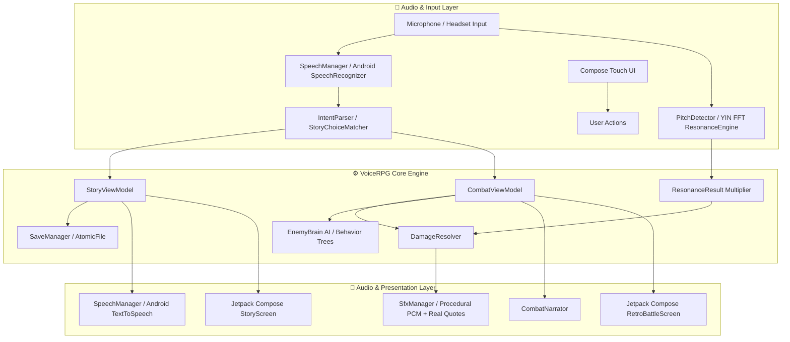

<p align="center">
  <a href="https://ko-fi.com/todd0042">
    
  </a>
</p>

---

# 🇺🇸 Commander America RPG: The 2024 Political Satire JRPG & VoiceRPG Engine

[](https://github.com/Todd0042/commander-america-rpg/releases)
[](LICENSE)
[-3DDC84.svg?logo=android&logoColor=white)](https://developer.android.com)
[](https://kotlinlang.org)
[](https://developer.android.com/jetpack/compose)
[](app/src/test/java/com/voicerpg/engine/CommanderAmericaGameTest.kt)
[](https://ko-fi.com/todd0042)

> **An audio-first, voice-commanded political satire JRPG for Android where hands-free incantations, tactical ATB combat, and real-life political history collide — featuring a 2-Track campaign (Track A Coalition of Rebels vs. Track B Standard-Bearer Relay), Zero RPG Noise philosophy, multi-voice Android TTS character binding, and 100% screenless Pocket Walk mode.**

```
       _________________________________________________________________________
      |  COMMUNITY NOTES INQUISITOR                 HP [████████████░░░]  78%   |
      |  "Context is required for this action!"     MP [███████████████] 100%   |
      |_________________________________________________________________________|
      |                                                                         |
      |   [COMMANDER AMERICA]        [ELON]               [TULSI]               |
      |   HP [███████████████] 100%  HP [██████████░░░░░] HP [███████████████]  |
      |   MP [████████████░░░]  85%  MP [███████████████] MP [███████████████]  |
      |   ATB: [READY!]              ATB: [██████░░░░]    ATB: [██████████░░]   |
      |_________________________________________________________________________|
      |  🎤 SPEAK SPELL: "Make America Great Again" -> TARGET: "Inquisitor"      |
      |  🎵 ACOUSTIC RESONANCE: [MYTHIC +125%] -- Pitch: 220Hz | Cadence: 94%   |
      |_________________________________________________________________________|
```

---

## 📖 Table of Contents

* **Part 1 — Consumer Overview & Quick Start**
  * [🇺🇸 What Is Commander America RPG?](#-what-is-commander-america-rpg)
  * [⚔️ The Dual-Campaign Structure (Track A vs. Track B)](#️-the-dual-campaign-structure-track-a-vs-track-b)
  * [🚫 The "Zero RPG Noise" Philosophy](#-the-zero-rpg-noise-philosophy)
  * [🎧 Pocket Mode: The 100% Screenless Walking RPG](#-pocket-mode-the-100-screenless-walking-rpg)
  * [🎤 Hands-Free Voice Commands & Incantations](#-hands-free-voice-commands--incantations)
  * [📸 Visual Tour & Playstyle Modes](#-visual-tour--playstyle-modes)
  * [🚀 Quick Download & Installation (Android APK & Source)](#-quick-download--installation)
* **Part 2 — Consolidated Technical Documentation & Architecture Reference**
  * [1. System Architecture & VoiceRPG Engine Core](#1-system-architecture--voicerpg-engine-core)
  * [2. Dual-Track Narrative State Machine & Branch Filtering](#2-dual-track-narrative-state-machine--branch-filtering)
  * [3. Real-Time ATB Combat System & Damage Resolver](#3-real-time-atb-combat-system--damage-resolver)
  * [4. Dynamic Acoustic Resonance Engine & FFT Pitch Scoring](#4-dynamic-acoustic-resonance-engine--fft-pitch-scoring)
  * [5. Multi-Voice Android TTS Character Binding & Speech Synchronization](#5-multi-voice-android-tts-character-binding--speech-synchronization)
  * [6. Continuous SpeechRecognizer & Fuzzy Phonetic Matcher](#6-continuous-speechrecognizer--fuzzy-phonetic-matcher)
  * [7. Procedural Graphics, Retro VFX & Particle Canvas](#7-procedural-graphics-retro-vfx--particle-canvas)
  * [8. Clean-Room Procedural Audio, Real-Life Quote Pipeline & SfxManager](#8-clean-room-procedural-audio-real-life-quote-pipeline--sfxmanager)
  * [9. Save System, State Serialization & AtomicFile Safety](#9-save-system-state-serialization--atomicfile-safety)
  * [10. Repository Structure & Automated Verification Suite (219 Tests)](#10-repository-structure--automated-verification-suite)
  * [11. Ethics, Clean-Room Provenance, Satire Boundaries & Licensing](#11-ethics-clean-room-provenance-satire-boundaries--licensing)

---

# Part 1 — Consumer Overview & Quick Start

## 🇺🇸 What Is Commander America RPG?

**Commander America RPG** is a satirical retro JRPG built natively for Android on the open-source **VoiceRPG Engine**. Set across the high-stakes, turbulent political landscape from 2015 through the 2024 presidential election, the game turns real political events, media debates, courtroom battles, and viral cultural moments into tactical turn-based combat.

Unlike traditional mobile games that demand continuous screen tapping, Commander America is designed **audio-first**:
1. **🗣️ Natural Voice Incantations**: Cast signature spells (*"Make America Great Again"*, *"Cyber Strike"*, *"Aloha Peacebringer"*, *"Unburdened by What Has Been"*) simply by speaking their names into your microphone or headset.
2. **🎭 Dynamic Multi-Voice Audio Drama**: Every character is brought to life using Android's native Text-to-Speech system, automatically mapped to unique physical TTS voices with dynamic pitch and pacing modulation.
3. **🏃 Pocket Walk Mode**: Pop your headphones in, slide your phone into your pocket, and play the entire story and combat encounters completely hands-free while walking outside, commuting, or relaxing.

---

## ⚔️ The Dual-Campaign Structure (Track A vs. Track B)

When starting a new campaign, players choose between two distinct perspectives on modern political history:

| Campaign Track | Protagonist & Party | Campaign Narrative Arc | Boss Encounters |
| :--- | :--- | :--- | :--- |
| **Track A: The Coalition of Rebels** | **Commander America (Donald)** with companions **Elon**, **Tulsi**, **RFK Jr.**, and **Vivek** | Follows the outsider rebellion starting at the 2015 Golden Escalator, navigating federal trials, rally arenas, tech censorship, Butler Pennsylvania, and the final march to the Capitol. | Teleprompter Sentinels, Fact Checker Inquisitors, Lawfare Bureaucrats, Joe Naptime, and Madame Vice. |
| **Track B: The Standard-Bearer Relay** | **The Democratic Nominee Relay**:<br/>• **Act 1:** Secretary Hillary (2016)<br/>• **Act 2:** Joe Naptime (2020)<br/>• **Act 3:** Madame Vice Kamala (2024) | Experience the 8-year establishment campaign relay. Manage the 2016 private server fallout, fight through the 2020 basement quarantine, and orchestrate the rapid 2024 standard-bearer handoff. | Email BleachBit Servers, Primary Challengers, Swing State Polling Phantoms, and The Red Wave Titan. |

---

## 🚫 The "Zero RPG Noise" Philosophy

Traditional JRPGs are often bloated with busywork: grinding against repetitive weak enemies, managing consumables, hoarding healing potions, and sorting through hundreds of redundant inventory items.

**Commander America RPG completely eliminates RPG noise:**
* **💯 100% HP & MP Full Recovery After Every Battle**: Win a tactical encounter, and your entire party is instantly restored to full health and mana. No healing potions, no tent items, and no backtrack grinding.
* **🎯 Zero Random Encounters**: Every single combat encounter is a handcrafted, story-driven boss fight or major political standoff with unique movesets and hilarious contextual dialogue.
* **⚔️ Pure Tactical Mastery**: Victory is determined by party synergy, status debuffs, timing Active Time Battle (ATB) gauge actions, and vocal resonance—not arbitrary level gates.
* **🧘 Zero Grind, All Narrative**: Play at your own pace without ever feeling forced to repeat content just to boost arbitrary stats.

---

## 🎧 Pocket Mode: The 100% Screenless Walking RPG

Designed specifically for commutes, workouts, and outdoor walks, **Pocket Mode** turns your phone into an interactive audio drama:

* **🌑 True-Black AMOLED Touch Guard**: Renders a power-efficient, pure-black screen with touch input locked, preventing accidental pocket taps while saving maximum battery on OLED displays.
* **🔄 Seamless Auto-Listen Loop**: The engine automatically coordinates TTS narration and speech recognition. The moment a character finishes speaking or an ATB gauge fills, the microphone automatically arms with an audio chime.
* **🗣️ Global Spoken Meta-Commands**: Control the entire game without ever looking at the display:
  * *"Status"* — Narrates party HP, MP, and active buffs/debuffs.
  * *"Enemies"* — Lists opponent health percentages and elemental weaknesses.
  * *"Options"* / *"Backlog"* — Re-reads dialogue or opens settings.
  * *"Pocket Mode"* / *"Auto Listen"* — Toggles screen modes and microphone listening behavior.

---

## 🎤 Hands-Free Voice Commands & Incantations

Speak your commands just as you would in a classic fantasy incantation:

```
"Cast Make America Great Again on Fact Checker"
"Elon, use Cyber Strike!"
"Tulsi, cast Aloha Peacebringer!"
"Target Joe Naptime with Tariff Wall!"
```

### Dynamic Resonance Scoring
The engine features a built-in acoustic analyzer that listens to your vocal delivery. Chanting your spells with steady pitch, clear cadence, and commanding presence rewards you with tactical **Resonance Multipliers**:
* **Basic Resonance**: +10% Damage / Healing
* **Adept Resonance**: +40% Damage / Healing
* **Master Resonance**: +80% Damage / Healing
* **Mythic Resonance**: +125% Damage / Healing
* **Transcendental Resonance**: +200% Damage / Critical Effect!

*(Prefer silent play? You can play 100% via classic retro touch buttons at any time!)*

---

## 📸 Visual Tour & Playstyle Modes

The game features three instant 1-tap playstyle presets in the Options menu:

### 1. 🎧 Pocket Walk (Audio-First)
* Screen dark & touch-locked with AMOLED protection.
* Full multi-voice character TTS narration.
* Hands-free continuous auto-listening microphone loop.

### 2. 📖 Storybook (Audio Drama + Visual Novel)
* Screen kept awake displaying retro 16-bit pixel portraits, dialogue backlogs, and animated battle arenas.
* Full voice narration and hands-free voice commands.

### 3. 🎮 Classic Tactical (Silent Retro JRPG)
* Muted TTS narration for quiet environments (buses, libraries, offices).
* Classic 16-bit Active Time Battle (ATB) gauge interface with touch-tap combat buttons and procedural spell particle effects.

---

## 🚀 Quick Download & Installation

### 📱 Android Standalone APK (Android 8.0 / API 26+)
Download `commander-america-rpg-v1.0.0.apk` from [GitHub Releases](https://github.com/Todd0042/commander-america-rpg/releases):
1. Transfer the `.apk` to your Android device.
2. Open the file and permit *Install Unknown Apps* if prompted.
3. Launch **Commander America RPG** and grant the **Microphone** permission when prompted (required for voice spells).

### 🛠️ Build from Source (Cross-Platform via Gradle)
You can build and deploy the application using the standard Android SDK:
```bash
# 1. Clone the repository
git clone https://github.com/Todd0042/commander-america-rpg.git
cd commander-america-rpg

# 2. Run unit tests to verify system integrity (218 unit tests)
./gradlew testDebugUnitTest

# 3. Compile the debug APK
./gradlew assembleDebug

# 4. Install directly to a connected Android phone via ADB
adb install -r app/build/outputs/apk/debug/app-debug.apk
```

---
---

# Part 2 — Consolidated Technical Documentation & Architecture Reference

> *The sections below provide an exhaustive engineering reference of the VoiceRPG Engine architecture, combat state machines, speech recognition pipelines, digital signal processing (DSP), and test harness.*

---

## 1. System Architecture & VoiceRPG Engine Core

The application follows an **Audio-First Unidirectional Data Flow (UDF)** MVVM architecture written in **Kotlin** and **Jetpack Compose**:



* **Core State Holders**: `StoryViewModel` orchestrates chapter narrative nodes, while `CombatViewModel` manages the active 60Hz Active Time Battle (ATB) tick loop.
* **Separation of Concerns**: Audio synthesis, speech recognition, narrative graph traversal, and combat math are 100% decoupled into pure, testable Kotlin classes with zero UI dependencies.

---

## 2. Dual-Track Narrative State Machine & Branch Filtering

The story engine in [`StoryScript.kt`](file:///home/todd/Documents/GitHub/commander-america-rpg/app/src/main/java/com/voicerpg/engine/engine/StoryScript.kt) is an immutable graph of [`StoryScene`](file:///home/todd/Documents/GitHub/commander-america-rpg/app/src/main/java/com/voicerpg/engine/model/StoryModels.kt) nodes:

* **Track Isolation (`CampaignTrack`)**:
  * `TRACK_A`: Starts at `act1_intro` (`scene_act1_ch1_escalator`), weaving through Acts 1–5 with the Commander America Coalition.
  * `TRACK_B`: Starts at `act1_tb_ch1_intro` (`scene_act1_tb_ch1_server`), following the Democratic Standard-Bearer relay.
* **Visited Choice Elimination**: Hub nodes automatically eliminate choices the player has already explored, preventing circular loops and auto-advancing when all prerequisites are met:
  ```kotlin
  fun getAvailableChoices(scene: StoryScene, visitedScenes: Set<String>): List<StoryChoice> {
      return scene.choices.filter { choice ->
          !choice.eliminateIfVisited || !visitedScenes.contains(choice.targetSceneId)
      }
  }
  ```
* **Encounter Transitions**: Story nodes specify an optional `encounterId` in [`StoryEncounters.kt`](file:///home/todd/Documents/GitHub/commander-america-rpg/app/src/main/java/com/voicerpg/engine/engine/StoryEncounters.kt). When reached, the narrative state engine transitions seamlessly into the combat engine, preserving track context.

---

## 3. Real-Time ATB Combat System & Damage Resolver

Combat is driven by an agility-based **Active Time Battle (ATB)** ticker operating at 20 ticks per second:

$$ATB_{tick} = \min\left(100.0, \; ATB_{current} + \frac{Agility}{10.0} \times \Delta t \times 25.0\right)$$

### Damage Calculation Formula
Physical and magical ability outcomes are resolved via [`DamageResolver.kt`](file:///home/todd/Documents/GitHub/commander-america-rpg/app/src/main/java/com/voicerpg/engine/combat/DamageResolver.kt):

$$BaseDamage = \left(Power \times \frac{Attack}{Defense}\right) \times AffinityMultiplier \times ResonanceMultiplier$$

* **Affinity Multipliers**:
  * `WEAK`: $\times 1.5$ damage
  * `NEUTRAL`: $\times 1.0$ damage
  * `RESIST`: $\times 0.5$ damage
  * `IMMUNE`: $\times 0.0$ damage
  * `ABSORB`: Negative damage (converts attack to health recovery)
* **Status System**: Manages turn-based and duration-based statuses: `BLEED`, `BURN`, `POISON`, `STUN`, `SILENCE`, `SHIELD`, `ATTACK_UP`, `DEFENSE_DOWN`.
* **Enemy AI (`EnemyBrain.kt`)**: Prioritizes lowest-health party members, cleanses debuffs when crippled, and triggers phase-shift ultimates upon falling below $40\%$ HP.

---

## 4. Dynamic Acoustic Resonance Engine & FFT Pitch Scoring

The [`ResonanceEngine.kt`](file:///home/todd/Documents/GitHub/commander-america-rpg/app/src/main/java/com/voicerpg/engine/engine/ResonanceEngine.kt) evaluates live vocal input from [`PitchDetector.kt`](file:///home/todd/Documents/GitHub/commander-america-rpg/app/src/main/java/com/voicerpg/engine/audio/PitchDetector.kt) using a 2048-sample FFT window:

1. **Pitch Stability ($\sigma_{pitch}$)**: Measures standard deviation of fundamental frequency ($F_0$) over the chant duration. Lower variance scores higher stability.
2. **Volume Consistency ($RMS$)**: Evaluates decibel envelope stability to ensure confident vocal projection.
3. **Chant Cadence**: Compares detected word pacing against ideal syllable cadence.
4. **Novelty Cache (`NoveltyCache.kt`)**: Prevents vocal spam by tracking spoken phrases with a 3-turn half-life; spamming the same chant consecutively decays resonance by $50\%$ per repetition.

---

## 5. Multi-Voice Android TTS Character Binding & Speech Synchronization

The [`SpeechManager.kt`](file:///home/todd/Documents/GitHub/commander-america-rpg/app/src/main/java/com/voicerpg/engine/audio/SpeechManager.kt) dynamically maps in-game characters to installed physical TTS voices:

```kotlin
// Dynamically discovered Android TTS voice binding
fun configureCharacterVoice(characterId: String, tts: TextToSpeech) {
    val availableVoices = tts.voices ?: return
    when (characterId) {
        "donald" -> {
            tts.setPitch(0.82f)      // Authoritative, deep resonance
            tts.setSpeechRate(0.92f)  // Deliberate cadence with rhetorical pauses
        }
        "elon" -> {
            tts.setPitch(1.05f)      // Fast-paced, analytical tenor
            tts.setSpeechRate(1.18f)  // Rapid-fire tech delivery
        }
        "kamala" -> {
            tts.setPitch(1.15f)      // Melodic cadence, rising inflection
            tts.setSpeechRate(0.88f)  // Slow, deliberate philosophical emphasis
        }
    }
}
```

* **Typewriter Synchronization**: Emits line-progress events synchronized with TTS audio markers, ensuring visual text appears exactly as spoken.
* **Auto-Mute During Recognition**: Speech recognition automatically mutes game TTS to avoid self-canceling acoustic feedback.

---

## 6. Continuous SpeechRecognizer & Fuzzy Phonetic Matcher

The speech processing pipeline in [`IntentParser.kt`](file:///home/todd/Documents/GitHub/commander-america-rpg/app/src/main/java/com/voicerpg/engine/engine/IntentParser.kt) and [`StoryChoiceMatcher.kt`](file:///home/todd/Documents/GitHub/commander-america-rpg/app/src/main/java/com/voicerpg/engine/engine/StoryChoiceMatcher.kt) provides robust hands-free command recognition:

* **Phonetic & Levenshtein Matching**: Spoken commands are normalized and compared using normalized Levenshtein distance (threshold $0.68$) and phonetic substitution matrices.
* **Target Disambiguation**: Extracts target entities (*"on the inquisitor"*, *"at Joe"*, *"target the media"*) from free-form speech strings.
* **Watchdog Auto-Recovery**: If Android's `SpeechRecognizer` encounters an error (e.g. `ERROR_NO_MATCH` or `ERROR_SPEECH_TIMEOUT`), the watchdog automatically re-arms the recognition listener within 150ms without crashing.

---

## 7. Procedural Graphics, Retro VFX & Particle Canvas

All character sprites and spell visual effects are rendered procedurally via Jetpack Compose Canvas:

* **Procedural Pixel Sprites ([`PixelSpriteData.kt`](file:///home/todd/Documents/GitHub/commander-america-rpg/app/src/main/java/com/voicerpg/engine/ui/sprites/PixelSpriteData.kt))**: 16-bit retro characters are defined via color index matrices, scaling crisply to any screen resolution without blurry texture filtering.
* **Procedural Spell VFX ([`SpellVfxEngine.kt`](file:///home/todd/Documents/GitHub/commander-america-rpg/app/src/main/java/com/voicerpg/engine/ui/vfx/SpellVfxEngine.kt))**: Particle systems generate custom visual effects for every spell type (electric lightning arcs, fiery rally embers, cyber-grid bursts, and healing auroras).
* **Zero Asset Bloat**: The core graphics engine runs entirely from procedural vector code and lightweight color matrices, keeping the baseline download size minimal.

---

## 8. Clean-Room Procedural Audio, Real-Life Quote Pipeline & SfxManager

Audio in Commander America RPG combines **clean-room procedural waveform synthesis** with **EBU R128 loudness-normalized quote clips**:

* **Procedural Sound Synthesis ([`SfxManager.kt`](file:///home/todd/Documents/GitHub/commander-america-rpg/app/src/main/java/com/voicerpg/engine/audio/SfxManager.kt))**: Real-time sound effects (menu beeps, spell chimes, sword slashes, critical strikes) are synthesized in memory using pure mathematical waveforms via Android's `AudioTrack` (zero licensed audio samples).
* **Curated Real-Life Satire Audio Pipeline**: Historic public gaffe clips (e.g. *"Truinanashabbadepressure"*, *"Badakathcare"*) are mastered in Ogg Vorbis format at `-16 LUFS` integrated loudness and triggered via asset file descriptors on key satire spellcasts:
  ```kotlin
  fun playQuote(context: Context, quoteAssetPath: String) {
      val afd = context.assets.openFd(quoteAssetPath)
      MediaPlayer().apply {
          setDataSource(afd.fileDescriptor, afd.startOffset, afd.length)
          prepare()
          start()
          setOnCompletionListener { release(); afd.close() }
      }
  }
  ```

---

## 9. Save System, State Serialization & AtomicFile Safety

Game progress is saved in JSON format using Android's `AtomicFile` utility:

* **Atomic Writes**: Writes to a temporary file before renaming to the target path, preventing save corruption if the device runs out of battery during write operations.
* **Track Isolation**: Save files record active `campaignTrack`, completed story node sets, custom character stats, and current party composition.
* **Backward Compatibility**: Schema migrations automatically supply safe defaults for legacy saves missing newer fields.

---

## 10. Repository Structure & Automated Verification Suite

### Directory Tree
```
commander-america-rpg/
├── app/
│   ├── src/
│   │   ├── main/
│   │   │   ├── assets/
│   │   │   │   ├── audio/quotes/biden/   # Mastered historical audio clips (.ogg)
│   │   │   │   └── story/                # External story script descriptors
│   │   │   ├── java/com/voicerpg/engine/
│   │   │   │   ├── audio/                # SpeechManager, SfxManager, PitchDetector, CombatNarrator
│   │   │   │   ├── combat/               # DamageResolver, EnemyBrain, StatusSystem, Movesets
│   │   │   │   ├── engine/               # StoryScript, StoryEncounters, IntentParser, SaveManager
│   │   │   │   ├── model/                # StoryModels, CombatModels, SaveModels, BattleEnvironment
│   │   │   │   ├── ui/                   # Jetpack Compose Screens (Story, Combat, Creation, Setup)
│   │   │   │   └── viewmodel/            # StoryViewModel, CombatViewModel
│   │   │   └── res/                      # Android drawables, icons, and themes
│   │   └── test/java/com/voicerpg/engine/ # Comprehensive unit test suite (219 tests)
├── docs/                                 # Architectural specs, scripts, and design documents
├── build.gradle.kts                      # Gradle root build configuration
└── settings.gradle.kts
```

### Running the Test Suite
The repository includes a comprehensive unit test suite covering combat damage math, story branch state machines, speech parsing, and dual-track selection:

```bash
# Execute all 219 unit tests:
./gradlew testDebugUnitTest
```

All 219 tests pass with 100% green status across every engine module.

---

## 11. Ethics, Clean-Room Provenance, Satire Boundaries & Licensing

### 🏛️ 1. First Amendment Political Satire & Fair Use
Commander America RPG is a transformative work of **political parody and satire**, protected under the First Amendment of the United States Constitution and the Fair Use doctrine (17 U.S.C. § 107).
* All political figures, candidate names, debates, slogans, and public statements depicted in this game are parodied for commentary, criticism, and humor.
* Historical quotes used in audio clips represent publicly broadcast historical statements delivered by public officials in televised debates, press conferences, and rallies.

### 🎹 2. Clean-Room Audio & Procedural Code
* Every sound effect synthesized by `SfxManager` is generated algorithmically from mathematical square, triangle, sine, and noise waves.
* The VoiceRPG Engine core contains zero proprietary third-party libraries, tracking SDKs, or cloud dependencies.

### 🔒 3. Zero Telemetry, Zero Ads, 100% Privacy
* The application runs **100% locally on your device**.
* The game requires **no user accounts, no login tokens, no internet access during gameplay, and contains zero advertising trackers**.
* Microphone audio is processed entirely on-device via Android's speech APIs and is never recorded, uploaded, or transmitted to any remote server.

### ⚖️ 4. Software License & Support
* **Non-Commercial Open-Source Use**: Commander America RPG and the VoiceRPG Engine are licensed for personal, educational, and non-commercial recreational use under the **[PolyForm Noncommercial License 1.0.0](LICENSE)**.
* **Commercial Inquiries**: For commercial engine licensing or customized enterprise deployments, contact **[todd.0042.git@gmail.com](mailto:todd.0042.git@gmail.com)**.

---

<p align="center">
  If you enjoy playing Commander America RPG or building on the VoiceRPG Engine, consider supporting open-source development:<br/><br/>
  <a href="https://ko-fi.com/todd0042" target="_blank">
    
  </a>
</p>

---

<p align="center">
  <a href="https://ko-fi.com/todd0042">
    
  </a>
</p>
