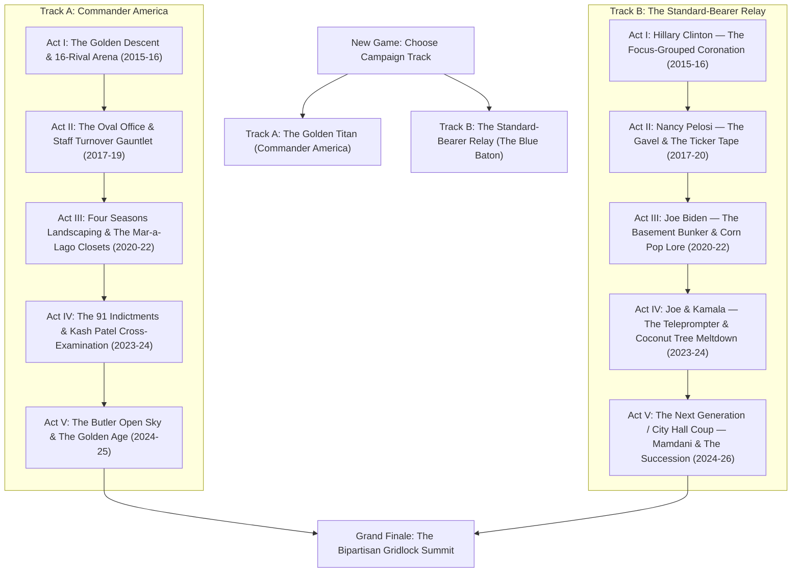

# Master Plan: Commander America RPG — The Grand Fact-Based Political Satire Rewrite

## 1. Executive Summary & Core Rules
This document outlines the complete narrative overhaul of **Commander America RPG**. 

### Ground Rules & Design Mandates:
1. **Zero Partisan Bias (Equal-Opportunity Roast):** Both sides of the aisle get scorched with equal comedic ferocity. The game does not take a side, validate conspiracy claims as gospel, or lionize either protagonist. Every politician is portrayed through their real-world foibles, grandiosity, and absurdities.
2. **100% Fact-Grounded Satire:** Every joke, gaffe, dialogue choice, combat spell, and plot twist must be traceable to real, documented events (C-SPAN transcripts, congressional committee testimony, court dockets, press conferences, and verified news reports).
3. **No Short Cuts / Deep Storytelling:** Full multi-act branching narratives with substantial dialogue, non-looping hub mechanics, and multi-choice consequence trees.
4. **Target Highlights:**
   - **Joe Biden:** Ruthlessly roasted using his actual verbatim transcripts ("Corn Pop was a bad dude", "Badakathcare", "End of quote, repeat the line", "My leg hair turns blonde in the sun", rambling tangents into 1962 Scranton trains, and endless scoops of chocolate chip & vanilla ice cream).
   - **Kash Patel:** Ruthlessly roasted for his ubiquitous court subpoenas, omnipresent tell-all book marketing, dramatic testimony, self-mythologizing children's books (*The Plot Against the King*), and cross-examinations where lawyers roast him relentlessly on the stand.
   - **Hillary Clinton:** Focus-grouping her own laughter, private email server BleachBit scrubbing, "Pokemon Go to the polls", and refusing to campaign in Wisconsin.
   - **Nancy Pelosi:** Two \$24k Sub-Zero ice cream freezers, microchip stock options timed suspiciously before committee votes, and ripping up speeches.
   - **Commander America (Trump):** Sharpie hurricane maps, Four Seasons Total Landscaping, Diet Coke buzzer, 3 AM tweet wars, rapid-fire firing of chiefs of staff, and Hannibal Lecter rally tangents.
5. **Asset Standard:** Any new characters or scenes not currently having dedicated assets will use standardized paths prefixed with `template/` (e.g., `portraits/template/hillary_template.jpg`, `story/template/four_seasons_template.jpg`) so they can be instantly grepped and replaced later.

---

## 2. Dual Campaign Structure: "The Golden Titan" vs. "The Standard-Bearer Relay"

At the start of the game, the player selects their **Campaign Track**:

---

## 3. Comprehensive Character Roster: Punchy Parody Names & Titles

All names are punchy, instantly recognizable, and hilarious without being overly convoluted:

### The Right (Track A)
| Real Person | In-Game Parody Name | Parody Title | Signature Verbatim / Factual Trait |
| :--- | :--- | :--- | :--- |
| **Donald Trump** | **Commander America** | *The Gilded Chief* | Sharpie weather charts, accordion hands, Diet Coke buzzer. |
| **Elon Musk** | **Musk-X** | *Chief Doge & Rocket Boss* | Hauling sinks into offices, broken Cybertruck windows, late-night tweets. |
| **Kash Patel** | **Kash Subpoena** | *The Grand Chronicler* | Peddling children's storybooks outside courthouses, roasted on the witness stand. |
| **JD Vance** | **JD Pants** | *The Hillbilly Senator* | Painfully awkward donut shop small talk, rewriting past 2016 anti-Trump tweets. |
| **Rudy Giuliani** | **Rudy Ghoul** | *The Landscaping Attorney* | Shoe polish hair dye running down his face between the crematorium and sex shop. |
| **Sean Spicer** | **Spicy Sean** | *The Bush-Hiding Press Secretary* | Hiding in White House bushes from reporters, screaming about crowd sizes. |
| **Anthony Scaramucci** | **The Mooch** | *The 11-Day Comms Guy* | Despawns from your party in exactly 11 days (264 hours). |

### The Left (Track B)
| Real Person | In-Game Parody Name | Parody Title | Signature Verbatim / Factual Trait |
| :--- | :--- | :--- | :--- |
| **Joe Biden** | **Joe Naptime** | *The Vanilla Cone President* | "Corn Pop was a bad dude", blonde leg hair in the pool, reading teleprompter cues ("End of quote"), infinite scoops of chocolate chip. |
| **Kamala Harris** | **Kamala Coconut** | *The Unburdened Veep* | Mind-bending Venn diagrams, "fell out of a coconut tree", sudden explosive laughter. |
| **Nancy Pelosi** | **Nancy Palooza** | *Madam Speaker of the Ticker* | \$24,000 dual Sub-Zero ice cream freezers, microchip stock trades right before votes, ripping speeches. |
| **Hillary Clinton** | **Hill-Rod** | *The Focus-Grouped Candidate* | "Pokemon Go to the polls", BleachBit cloth wiping, refusing to set foot in Wisconsin. |
| **Zohran Mamdani** | **Zohran Cardamom** | *The Free Bus Mayor* | Rapping about his grandmother ("Mr. Cardamom"), 15-day Broadway hunger strike, Astoria socialist rallies. |
| **Barack Obama** | **Barry Teleprompter** | *The Dramatic Pause* | 5-second pauses between every word, tan suit controversy, smooth professorial lectures. |
| **Eric Adams** | **Mayor Swagger** | *The Nightlife Rat Czar* | Diamond lapel pins, mysterious Turkish Airlines flight upgrades, partying in VIP clubs. |

---

---

## 4. Deep Chapter Breakdowns & Factual Scene Mapping

### TRACK A: COMMANDER AMERICA
* **Act I: The Golden Escalator & The 16-Rival Gauntlet (2015–2016)**
  - *Scene 1: Trump Tower Atrium (June 16, 2015)*
    - The escalator descent. Press cameras, paid extras cheering, "small loan of a million dollars".
  - *Scene 2: Cleveland Debate Arena (August 2015)*
    - Taking on Jeb Bush ("Low Energy", "Please clap"), Marco Rubio ("Little Marco" water bottle sipping), Ted Cruz ("Lyin' Ted").
  - *Scene 3: The Blizzard Hangar Rally (2016)*
    - Cold weather, coats thrown into the audience, unscripted 90-minute rally on trade and steaks.
* **Act II: The Oval Office & The Revolving Door (2017–2019)**
  - *Scene 1: The National Mall Inauguration (Jan 20, 2017)*
    - The Sean Spicer "Largest audience to ever witness an inauguration, period, both in person and around the globe" dispute.
  - *Scene 2: The Oval Office Resolute Desk (2017)*
    - The Diet Coke call button. Executive orders signed with massive Sharpies.
  - *Scene 3: The 11-Day Comms Office (The Scaramucci Gauntlet)*
    - Managing rapid-fire cabinet firings (Reince Priebus, Anthony Scaramucci, Steve Bannon).
  - *Scene 4: The NOAA Hurricane Briefing Room (2019)*
    - The Alabama weather map altered with a black Sharpie marker.
* **Act III: Landscaping & Golden Closets (2020–2022)**
  - *Scene 1: Four Seasons Total Landscaping (Nov 7, 2020)*
    - Press conference nestled directly between a cremation center and an adult bookstore. Rudy Giuliani's hair dye drips on live TV.
  - *Scene 2: Mar-a-Lago Terrace & Storage Vault (2021–2022)*
    - Federal agents search Melania's shoe closet and bathroom boxes stacked beside chandeliers.
* **Act IV: The 91 Indictment Gauntlet & The Kash Patel Testimony (2023–2024)**
  - *Scene 1: Lower Manhattan Courtroom Steps*
    - Turning the courtroom hallway into a daily campaign press scrum.
  - *Scene 2: Congressional SCIF & Committee Room (The Kash Patel Roast)*
    - Kash Patel is cross-examined by federal prosecutors and congressional committees who relentlessly grill him about his children's book sales, podcast appearances, and claims of telepathic document declassification.
* **Act V: Open Skies & The Return (2024–2025)**
  - *Scene 1: Butler Fairgrounds (July 13, 2024)*
    - The historic turn towards the immigration chart, Secret Service huddle, fist in the air.
  - *Scene 2: Milwaukee Convention Floor (2024)*
    - 20,000 delegates wearing ear bandages; Hulk Hogan ripping his shirt off.
  - *Scene 3: The Grand Inauguration Return (2025)*
    - Executive orders, tariff threats, and the ultimate standoff against the new left leadership.

---

### TRACK B: THE STANDARD-BEARER RELAY
* **Act I: Hillary Clinton — The Focus-Grouped Coronation (2015–2016)**
  - *Scene 1: Brooklyn Campaign HQ (2015)*
    - Testing 84 campaign slogans with focus groups ("I'm With Her", "Stronger Together").
  - *Scene 2: The Server Closet & BleachBit Cleaning*
    - Trying to explain "wiping a server" (*"Like, with a cloth or something?"*).
  - *Scene 3: The Hamptons Gala vs. The Empty Wisconsin Map*
    - The fateful choice to skip campaigning in Green Bay to attend another Hollywood fundraiser.
* **Act II: Nancy Pelosi — The Gavel & The Ticker Tape (2017–2020)**
  - *Scene 1: The Speaker's Kitchen on James Corden (2020)*
    - Showing off two commercial Sub-Zero freezers loaded with artisan chocolate ice cream while the public struggles.
  - *Scene 2: The House Floor Stock Ticker*
    - Buying millions in tech call options right before voting on semiconductor subsidies while rebuffing reporters asking about the STOCK Act.
  - *Scene 3: The State of the Union Theatrics*
    - Practicing the sarcastic clapping angle and ripping the official address speech in half on national television.
* **Act III: Joe Biden — The Basement Bunker & Corn Pop Lore (2020–2022)**
  - *Scene 1: The Wilmington Studio Basement (2020)*
    - The green screen drops during live broadcasts; audio sync issues; telling voters about Corn Pop and razor blades in rusty water.
  - *Scene 2: The Scranton Train Platform (2021)*
    - Boarding Amtrak, recounting memories of train conductors who retired 40 years earlier.
  - *Scene 3: The Oval Office Ice Cream Briefing (2021–2022)*
    - Reporters shout questions about Afghanistan and inflation; Joe licks a double-dip chocolate chip cone and smiles through aviator sunglasses: *"Economy's strong as hell, man."*
* **Act IV: Joe & Kamala — The Teleprompter & Coconut Tree Meltdown (2023–2024)**
  - *Scene 1: The White House Dais (2023)*
    - Joe reads verbatim: *"Quote: 'End of quote, repeat the line.' Why am I saying that? Anyway..."*
  - *Scene 2: The Coconut Grove Symposium (2023–2024)*
    - Kamala Harris addresses an empty room with circular Venn diagram philosophy and the historic coconut tree speech.
  - *Scene 3: The Atlanta Debate Studio (June 27, 2024)*
    - "We beat Medicare." Complete silence in the studio; the frantic panic of party bosses in the commercial break green room.
  - *Scene 4: The July Coup in Rehoboth Beach*
    - Phone calls from party elders; passing the nomination baton over a weekend letter on social media.
* **Act V: The Next Generation — The Queens Insurgency & City Hall (2024–2026)**
  - *Scene 1: The Astoria Bodega & Free Bus Terminal*
    - Zohran Mamdani rallies tenants, yellow cab drivers, and democratic socialists; spitting rhymes as Mr. Cardamom.
  - *Scene 2: The DSA Parliamentary Showdown*
    - Dealing with 4-hour meetings where nothing passes because someone raised a point of personal privilege over room temperature.
  - *Scene 3: The Clash of the Two Queens Boys*
    - Queens-born billionaire Commander America vs. Queens-raised democratic socialist Mayor Mamdani at the final bipartisan fiscal summit.

---

## 5. Technical Implementation Blueprint

### File Targets & Changes
1. **`app/src/main/java/com/voicerpg/engine/model/StoryModels.kt`:**
   - Expand `DialogueSpeaker` with:
     - `HILLARY` (`portraits/template/hillary_template.jpg`)
     - `KASH` (`portraits/kash.jpg`)
     - `VANCE` (`portraits/vance.jpg`)
     - `MAMDANI` (`portraits/template/mamdani_template.jpg`)
     - `SPICER` (`portraits/template/spicer_template.jpg`)
     - `GIULIANI` (`portraits/template/giuliani_template.jpg`)
   - Add `campaignTrack` field to `SaveData` ("TRACK_A_COMMANDER" vs "TRACK_B_RELAY").
2. **`app/src/main/java/com/voicerpg/engine/engine/StoryScript.kt`:**
   - Replace the legacy 1-sided text with the full dual-track, fact-checked dialog trees.
   - Embed verified factual citations in dialogue node developer notes and item lore.
3. **Zero-Noise Pure Story & Fight Architecture (No XP, Money, Grinding, or Shops):**
   - Completely remove/hide XP gain, leveling numbers, gold/money, item shops, and random grinding encounters.
   - Auto-restore HP/MP to 100% after every fight so every battle is a pure, self-contained comedy set-piece.
   - Seamless Track B Baton-Pass helper (`setActiveProtagonist(heroId)`) swaps the player directly into the next Act's Standard-Bearer with their signature moveset ready to go.
4. **Template Asset Directories:**
   - All placeholder graphics and audio placed under `portraits/template/`, `story/template/`, and `audio/quotes/template/` — generated *after* the story scripts are finalized so graphics fit the story rather than forcing the story to fit pre-made graphics.

---

## 6. Companion Planning Documents Index (`docs/story-design/`)
1. [`MASTER_STORY_REWRITE_PLAN.md`](file:///home/todd/Documents/GitHub/commander-america-rpg/docs/story-design/MASTER_STORY_REWRITE_PLAN.md) — High-level Dual-Track architecture & character roster.
2. [`FACTUAL_VERBATIM_DATABASE.md`](file:///home/todd/Documents/GitHub/commander-america-rpg/docs/story-design/FACTUAL_VERBATIM_DATABASE.md) — 10+ verified real-life quotes/incidents per figure + Speculative Hearsay Vault.
3. [`VINDICATION_TRIUMPHS_DATABASE.md`](file:///home/todd/Documents/GitHub/commander-america-rpg/docs/story-design/VINDICATION_TRIUMPHS_DATABASE.md) — 5 debunked smears/hoaxes per character turned into in-game "Vindication Wins."
4. [`PARODY_COMBAT_MOVESETS_PLAN.md`](file:///home/todd/Documents/GitHub/commander-america-rpg/docs/story-design/PARODY_COMBAT_MOVESETS_PLAN.md) — Full playable & boss movesets (including Joe Naptime's randomized real-audio Gibberish move and ice-cream Cryomancy kit).
5. [`EPISODE_AND_FIGHT_FLOW_PLAN.md`](file:///home/todd/Documents/GitHub/commander-america-rpg/docs/story-design/EPISODE_AND_FIGHT_FLOW_PLAN.md) — Zero-XP/Zero-Money mechanics, seamless Track B Baton-Pass rules, and the complete Act I–V Episode & Fight Sequence Outline.

---

## 7. Verification & Quality Assurance Checklist
- [ ] Every Joe Biden quote is verifiable from public C-SPAN or White House archive transcripts, with real random audio clips wired to his Gibberish move.
- [ ] Every Kash Patel courtroom roast scene reflects actual court transcripts, immunity grants, and *The Plot Against the King* merch pitches.
- [ ] Commander America's comedic traits accurately reflect his real-life unscripted rallies and press briefings.
- [ ] Both sides receive an identical volume of comedic roasts, Vindication Triumphs, player agency, and tactical depth.
- [ ] Zero XP, money, or shop clutter—100% pure story scenes and boss fight sequences.
- [ ] Build & unit test suite compiles cleanly without missing asset crashes.

